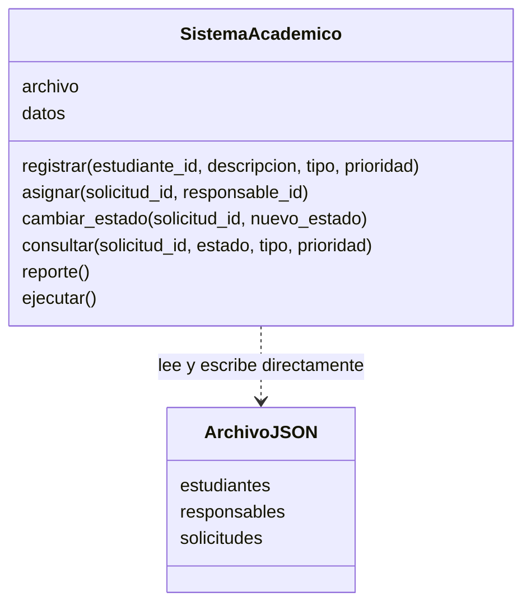
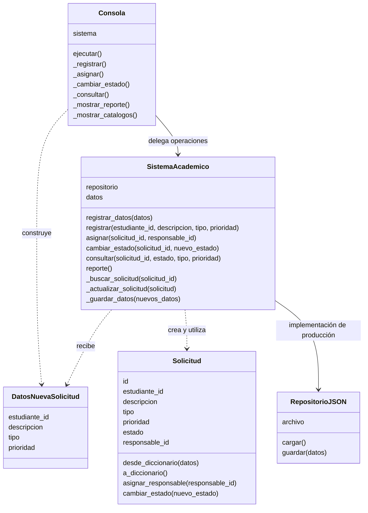

# Diseño inicial y refactorizado

## Diseño inicial

En la versión identificada con estado-inicial, la clase
SistemaAcademico concentra la interacción por consola, las operaciones
del negocio y el acceso al archivo JSON. Las solicitudes se representan
mediante diccionarios.

La representación ArchivoJSON corresponde al recurso de persistencia,
no a una clase implementada en Python.

Este diseño permite ejecutar las operaciones, pero reúne diferentes
motivos de cambio en una única clase. Además, las operaciones de
registro, asignación y cambio de estado repiten el procedimiento
de guardado.

## Diseño refactorizado

En la versión identificada con estadorefactorizado, la consola delega
las operaciones en el servicio. La entidad Solicitud contiene las reglas
de transición y asignación, mientras que RepositorioJSON administra
la lectura y escritura del archivo.

El punto de entrada main.py construye el repositorio, el servicio y
la consola. El servicio admite otro objeto que implemente cargar y
guardar; las pruebas utilizan RepositorioMemoria para verificar esa
sustitución.

No existe una clase abstracta de repositorio en esta implementación.
El contrato se expresa mediante los métodos que el servicio utiliza.
Por compatibilidad, el servicio también puede construir RepositorioJSON
si no recibe un repositorio.

La entidad Solicitud se utiliza durante las operaciones del dominio.
El conjunto de datos del servicio conserva diccionarios compatibles
con el JSON inicial; no se migró todo el almacenamiento a entidades.

## Cambios principales

| Aspecto | Versión inicial | Versión refactorizada |
|---|---|---|
| Interacción | Dentro de SistemaAcademico | Clase Consola |
| Persistencia | Lectura y escritura dentro del gestor | Clase RepositorioJSON |
| Guardado | Procedimiento repetido | Delegación centralizada |
| Registro | Cuatro argumentos separados | DatosNuevaSolicitud y adaptador compatible |
| Transiciones | Condicionales dentro del gestor | Método de la entidad Solicitud |
| Búsqueda por ID | Repetida en operaciones | Método _buscar_solicitud |
| Pruebas | 14 pruebas de comportamiento | Las mismas 14 y 6 adicionales |

## Límites de la mejora

La separación facilita probar y modificar responsabilidades de forma
aislada, pero no elimina todas las dependencias. El servicio conserva
una implementación JSON predeterminada y los mensajes del menú todavía
repiten algunos nombres del dominio.

Los diagramas describen las versiones identificadas en Git. No representan
una arquitectura web, autenticación ni componentes que no estén implementados.